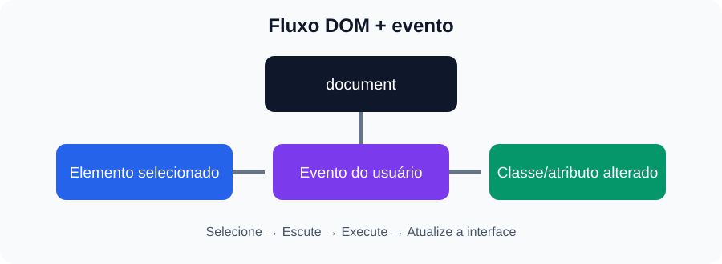
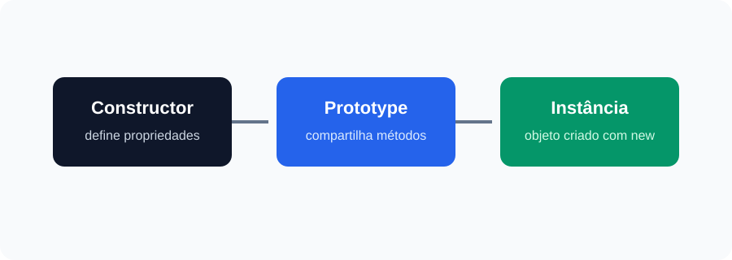

# Conceitos de JavaScript no Navegador

Este documento reúne conceitos aplicados ao DOM, aos objetos nativos e aos efeitos visuais presentes no repositório.

## DOM

O DOM, ou Document Object Model, representa o HTML da página como uma árvore de elementos que pode ser consultada e modificada por JavaScript.

```text
document
└── html
    ├── head
    └── body
        ├── nav
        ├── main
        └── footer
```

Cada elemento HTML é um objeto com propriedades, métodos e eventos.

## Seleção de elementos

As seleções permitem obter elementos específicos da página.

| Método | Uso |
|---|---|
| `getElementById` | Selecionar pelo atributo `id` |
| `querySelector` | Selecionar o primeiro elemento correspondente ao seletor |
| `querySelectorAll` | Selecionar todos os elementos correspondentes |

```js
const titulo = document.querySelector(".titulo");
const secoes = document.querySelectorAll(".grid-section");
```

## Classes e atributos

O método `classList` modifica classes sem substituir todas as classes existentes.

```js
elemento.classList.add("ativo");
elemento.classList.remove("ativo");
elemento.classList.toggle("ativo");
elemento.classList.contains("ativo");
```

Também é possível ler e alterar atributos HTML:

```js
elemento.getAttribute("href");
elemento.setAttribute("aria-expanded", "true");
```

## Eventos

Eventos representam ações disparadas pelo usuário ou pelo navegador.

```js
const botao = document.querySelector("button");

botao.addEventListener("click", () => {
  console.log("O botão foi clicado");
});
```

Eventos comuns incluem:

- `click`;
- `submit`;
- `keydown`;
- `scroll`;
- `mousemove`;
- `DOMContentLoaded`.

O fluxo básico é: selecionar elemento → ouvir evento → executar uma função → alterar a interface.

## Traversing

Traversing significa percorrer a estrutura DOM a partir de um elemento.

```js
elemento.parentElement;
elemento.children;
elemento.nextElementSibling;
elemento.previousElementSibling;
```

Essas propriedades permitem encontrar elementos relacionados sem depender exclusivamente de seletores.

## Dimensões e distâncias

As propriedades de tamanho e posição ajudam a criar animações e comportamentos condicionais.

```js
elemento.offsetHeight;
elemento.offsetWidth;
elemento.getBoundingClientRect();
window.scrollY;
window.innerHeight;
```

- `offsetHeight` e `offsetWidth` informam as dimensões visuais;
- `getBoundingClientRect()` informa posição e tamanho em relação à tela;
- `window.scrollY` informa quanto a página foi rolada;
- `window.innerHeight` informa a altura da área visível.

## Navegação por tabs

A navegação por tabs associa elementos de controle a painéis de conteúdo.

1. Selecionar os itens de navegação.
2. Selecionar os conteúdos.
3. Remover estados ativos.
4. Adicionar `.ativo` ao item selecionado.
5. Adicionar `.ativo` ao conteúdo correspondente.

Essa técnica é aplicada em `Aula-09.js` e usa animação CSS para mostrar o painel.

## Accordion

Um accordion mostra ou esconde um conteúdo relacionado ao título selecionado.

```js
const itens = document.querySelectorAll(".accordion dt");

itens.forEach((item) => {
  item.addEventListener("click", () => {
    item.classList.toggle("ativo");
    item.nextElementSibling.classList.toggle("ativo");
  });
});
```

## Scroll suave

Links internos podem navegar até uma seção pelo seu identificador. Com `scrollIntoView` é possível controlar o tipo de deslocamento.

```js
link.addEventListener("click", (evento) => {
  evento.preventDefault();
  const destino = document.querySelector(link.hash);
  destino.scrollIntoView({ behavior: "smooth" });
});
```

## Animação ao scroll

A animação ao scroll é ativada quando o elemento entra na área visível.

```js
function animaScroll() {
  secoes.forEach((secao) => {
    const topo = secao.getBoundingClientRect().top;

    if (topo < window.innerHeight * 0.6) {
      secao.classList.add("ativo");
    }
  });
}

window.addEventListener("scroll", animaScroll);
```

O estado inicial geralmente é definido em CSS e a classe `.ativo` altera opacidade, posição ou transformação.

## Constructor functions

Uma constructor function define o modelo usado para criar objetos semelhantes.

```js
function Pessoa(nome) {
  this.nome = nome;
}

const pessoa = new Pessoa("Gabriel");
```

O operador `new` cria uma nova instância e vincula `this` a ela.

## Prototype

O prototype permite que instâncias compartilhem métodos sem duplicar as funções em cada objeto.

```js
Pessoa.prototype.saudacao = function () {
  return `Olá, meu nome é ${this.nome}`;
};
```

Quando um método é solicitado, JavaScript procura primeiro no objeto e depois na cadeia de prototypes.

## Objetos nativos, host e usuário

- **Objeto nativo:** disponível no JavaScript, como `Object`, `Array`, `String`, `Number` e `Math`;
- **Objeto host:** fornecido pelo ambiente de execução, como `window` e `document` no navegador;
- **Objeto de usuário:** criado pelo desenvolvedor no código.

## Strings

O objeto `String` permite pesquisar e transformar textos.

```js
"JavaScript".toUpperCase();
"JavaScript".includes("Script");
"1,2,3".split(",");
"Javascript".replace("a", "A");
```

## Number e Math

`Number` representa valores numéricos e `Math` fornece operações matemáticas.

```js
Math.round(4.6);
Math.random();
Math.sqrt(16);
Math.pow(2, 3);
```

## Arrays

Os arrays possuem métodos de transformação e consulta.

| Método | Finalidade |
|---|---|
| `map` | Criar novo array transformado |
| `filter` | Filtrar itens |
| `forEach` | Percorrer itens |
| `find` | Retornar o primeiro item correspondente |
| `every` | Verificar se todos passam em uma condição |
| `some` | Verificar se pelo menos um passa em uma condição |
| `reduce` | Acumular os itens em um único resultado |
| `includes` | Verificar a existência de um valor |

## Function

Funções em JavaScript são objetos. Podem ser armazenadas em variáveis, passadas como argumentos e usadas como retornos.

```js
function executar(callback) {
  callback();
}
```

Métodos como `call`, `apply` e `bind` permitem controlar o contexto recebido por `this`.

## Object

O objeto global `Object` possui métodos para criar, consultar e proteger objetos.

```js
Object.keys(objeto);
Object.values(objeto);
Object.entries(objeto);
Object.getOwnPropertyNames(objeto);
Object.freeze(objeto);
Object.seal(objeto);
Object.preventExtensions(objeto);
```

Esses recursos permitem enumerar propriedades e controlar se elas podem ser modificadas, removidas ou adicionadas.

## Dataset

O módulo `Efeitos no DOM` possui a aula inicial de `Dataset`. O atributo `data-*` permite armazenar dados extras diretamente em elementos HTML.

```html
<button data-acao="abrir">Abrir</button>
```

```js
const botao = document.querySelector("[data-acao]");
console.log(botao.dataset.acao); // "abrir"
```

`dataset` transforma `data-nome-exemplo` em `elemento.dataset.nomeExemplo`.





## Índice das aulas

| Área | Aula | Conteúdo |
|---|---:|---|
| DOM | 01 | Conceito e estrutura do DOM |
| DOM | 02 | Integração com HTML e CSS |
| DOM | 03 | Seleção de elementos |
| DOM | 04 | `forEach` e arrow functions |
| DOM | 05 | Classes e atributos |
| DOM | 06 | Dimensões e distâncias |
| DOM | 07 | Eventos |
| DOM | 08 | Travessia e manipulação |
| DOM | 09 | Navegação por tabs |
| DOM | 10 | Lista accordion |
| DOM | 11 | Scroll suave |
| DOM | 12 | Animação ao scroll |
| Objetos | 01 | Constructor function |
| Objetos | 02 | Prototype |
| Objetos | 03 | Objetos nativos, host e usuário |
| Objetos | 04 | String |
| Objetos | 05 | Number e Math |
| Objetos | 06 | Array |
| Objetos | 07 | Array e iteração |
| Objetos | 08 | Function |
| Objetos | 09 | Object |
| Efeitos no DOM | 01 | Dataset |
