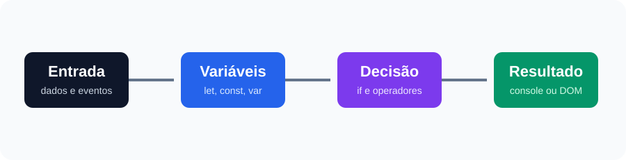

# Fundamentos do JavaScript

Este documento reúne os conceitos fundamentais estudados em `src/JS Para Iniciantes/` e `src/Tabela Verdade/`.

## Introdução

JavaScript é uma linguagem interpretada pelo navegador e por outros ambientes de execução. Seus principais usos neste projeto são:

- armazenar e manipular dados;
- realizar cálculos e comparações;
- controlar o fluxo de execução;
- responder a ações do usuário;
- consultar e alterar elementos da página.

## Variáveis

Variáveis armazenam valores para serem usados ou modificados durante a execução.

| Palavra-chave | Reatribuição | Escopo |
|---|---:|---|
| `var` | Permitida | Função |
| `let` | Permitida | Bloco |
| `const` | Não permitida | Bloco |

```js
var nome = "João";
let idade = 25;
const cidade = "São Paulo";
```

`var` é o formato mais antigo. Em código moderno, `let` é utilizado para valores que mudam e `const` para valores que não precisam ser reatribuídos.

## Tipos de dados

Os exercícios trabalham com os seguintes tipos:

- **String:** texto, por exemplo `"JavaScript"`;
- **Number:** número inteiro ou decimal, por exemplo `25` ou `3.14`;
- **Boolean:** `true` ou `false`;
- **Object:** coleção de pares chave/valor;
- **Array:** coleção ordenada de valores;
- **Function:** bloco reutilizável de instruções;
- **Undefined:** valor inexistente ou não definido;
- **Null:** ausência intencional de valor.

```js
const mensagem = "Olá";
const quantidade = 5;
const ativo = true;
const frutas = ["Maçã", "Banana"];
const pessoa = { nome: "Maria", idade: 30 };
```

Template strings permitem combinar texto e expressões:

```js
console.log(`Meu nome é ${pessoa.nome}.`);
```

## Operadores

### Operadores aritméticos

| Operador | Uso |
|---|---|
| `+` | Soma ou concatenação |
| `-` | Subtração |
| `*` | Multiplicação |
| `/` | Divisão |
| `%` | Resto da divisão |

### Operadores de comparação

| Operador | Significado |
|---|---|
| `>` | Maior que |
| `<` | Menor que |
| `>=` | Maior ou igual |
| `<=` | Menor ou igual |
| `===` | Estritamente igual |
| `!==` | Estritamente diferente |

O uso de `===` e `!==` evita comparações implícitas entre tipos diferentes.

### Operadores de incremento e decremento

```js
let idade = 20;
++idade; // incrementa antes de retornar o valor
idade++; // incrementa depois de retornar o valor
--idade;
idade--;
```

## Operadores booleanos

Os exercícios da tabela verdade demonstram a combinação de valores `true` e `false`.

### AND (`&&`)

O resultado só é `true` quando todas as condições forem verdadeiras.

| A | B | A && B |
|---|---|---|
| true | true | true |
| true | false | false |
| false | true | false |
| false | false | false |

### OR (`||`)

O resultado é `true` quando pelo menos uma condição for verdadeira.

| A | B | A \|\| B |
|---|---|---|
| true | true | true |
| true | false | true |
| false | true | true |
| false | false | false |

### NOT (`!`)

O operador NOT inverte o resultado.

| A | !A |
|---|---|
| true | false |
| false | true |

```js
!(true && false); // true
!(true || false); // false
```

## Condicionais

Condicionais determinam quais instruções serão executadas.

```js
const idade = 20;

if (idade >= 18) {
  console.log("Maior de idade");
} else {
  console.log("Menor de idade");
}
```

O operador ternário reduz uma decisão entre dois valores a uma única expressão:

```js
const resultado = idade >= 18 ? "Maior de idade" : "Menor de idade";
```

## Loops

Loops executam repetidamente uma sequência enquanto uma condição continuar válida.

```js
for (let contador = 1; contador <= 5; contador++) {
  console.log(contador);
}
```

Os arrays também podem ser percorridos por métodos como `forEach`, `map` e `filter`.

```js
const frutas = ["Maçã", "Banana", "Laranja"];

frutas.forEach((fruta) => {
  console.log(fruta);
});
```

## Funções

Uma função agrupa instruções reutilizáveis. Pode receber parâmetros e retornar um valor.

```js
function soma(a, b) {
  return a + b;
}

const resultado = soma(5, 3);
```

Funções podem ser usadas como callbacks para responder a eventos ou processar itens de arrays.

```js
const dobro = (numero) => numero * 2;
```

## Objetos

Objetos representam entidades por meio de pares chave/valor.

```js
const pessoa = {
  nome: "Gabriel",
  idade: 34,
  saudacao() {
    return `Olá, meu nome é ${this.nome}`;
  }
};
```

A propriedade `this` representa o contexto atual do objeto onde ela é utilizada.

## Arrays

Arrays armazenam uma coleção ordenada de valores.

| Método | Finalidade |
|---|---|
| `forEach` | Executar uma ação para cada item |
| `map` | Criar um novo array transformado |
| `filter` | Criar um novo array com itens que passam em uma condição |
| `find` | Encontrar o primeiro item correspondente |
| `includes` | Verificar se o valor existe no array |

```js
const numeros = [1, 2, 3, 4];
const pares = numeros.filter((numero) => numero % 2 === 0);
```

## Escopo

Escopo define em quais partes do código uma variável pode ser acessada.

```js
const nome = "João";

function mostrarNome() {
  const sobrenome = "Silva";
  console.log(nome, sobrenome);
}

mostrarNome();
```

- Variáveis `let` e `const` pertencem ao bloco em que foram declaradas.
- `var` pertence ao escopo da função em que foi declarada.
- Variáveis locais não podem ser utilizadas fora da função ou do bloco.

## Truthy e falsy

Além de `true` e `false`, JavaScript considera alguns valores falsos em condições:

- `false`;
- `0`;
- `""`;
- `null`;
- `undefined`;
- `NaN`.

Os demais valores são considerados verdadeiros.



## Índice das aulas

| Aula | Conteúdo |
|---|---|
| 01 | Introdução ao JavaScript |
| 02 | Variáveis e tipos de dados |
| 03 | Operadores e expressões |
| 04 | Operadores lógicos e incremento/decremento |
| 05 | Condicionais e operador ternário |
| 06 | Booleanos, condicionais e loop `for` |
| 07 | Funções |
| 08 | Objetos |
| 09 | Tudo é objeto |
| 10 | Arrays e loops |
| 11 | Atribuição e ternário |
| 12 | Escopo de variáveis |
